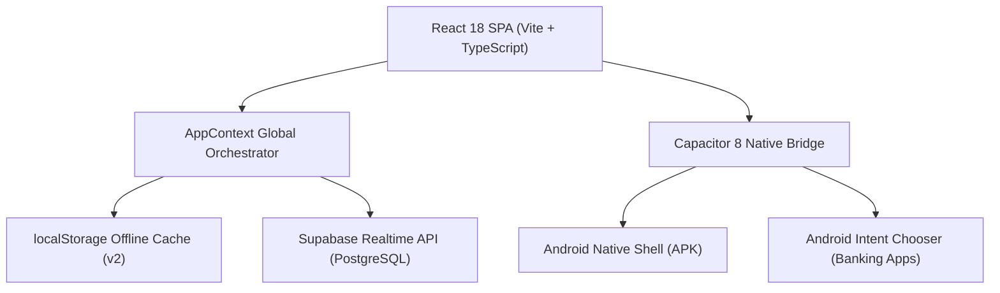

# ⚡ FORT | Digital Mutual-Aid Ledger & Micro-Loan System

[](https://react.dev/)
[](https://www.typescriptlang.org/)
[](https://capacitorjs.com/)
[](https://tailwindcss.com/)
[](https://supabase.com/)
[](https://github.com/features/actions)
[](https://opensource.org/licenses/MIT)

> **FORT** is a tactile, offline-first digital financial ledger and emergency loan tracking system tailored for community mutual-aid funds and peer savings pools. Built with high-performance 60/120fps motion design, native Android mobile integration, and resilient offline sync.

---

## 📱 Key Engineering Highlights

### 1. 🔄 Offline-First Resilient Data Engine
* **Instant Client-Side Bootstrap:** Zero-stall initial paint powered by persistent `localStorage` cache (`santha_cached_data_v2`).
* **Heartbeat & Visibility Sync:** Intelligently throttled 45-second background heartbeat and document visibility listeners that silently refresh records within Supabase free-tier egress limits.
* **Network Interceptor:** Built-in connection state listener (`navigator.onLine` / Capacitor Network) rendering an Apple-grade frosted amber `Offline Mode` indicator with manual retry actions.

### 2. ⚡ Native Android Chooser & Financial Transfer Sheet
* **Android OS Chooser Bridge:** Custom Capacitor 8 native intent bridge triggering `Intent.ACTION_CHOOSER` ("Complete action using: Q+ / BOC Flex / Vishwa / Commercial Bank / Notes").
* **Zero Clipboard Friction:** Automatically sanitizes and stamps the target account number onto the system clipboard before opening the transfer sheet.
* **Eliminated Play Store Redirection:** Replaced intrusive package store redirects with universal system share sheets for seamless peer banking across all mobile banking apps.

### 3. 🎨 Tactile Motion & Neo-Brutalist UI
* **60/120fps GPU Compositor Performance:** Framer Motion spring physics with `will-change: transform` GPU layer isolation, completely eliminating DOM layout thrashing and reflows.
* **Tactile Folder Navigation:** Custom physical folder tab interface on mobile and desktop designed for intuitive multi-year contribution inspection.
* **WhatsApp Snapshot Telemetry:** Generates optimized, high-contrast accounting cards designed for one-tap WhatsApp screenshots and meeting compliance reports.

### 4. 🤖 Automated Cloud APK Build Pipeline (CI/CD)
* **Zero-Touch Releases:** Fully automated GitHub Actions workflow compiling standalone release and debug Android APKs upon every tag or branch push.
* **Hermetic Toolchain:** Configured with Java JDK 21 (Zulu), Node 22, and Android Gradle Plugin 8.13 with CRLF line-ending sanitization and automated artifact uploads.

---

## 🏗️ Architecture & Tech Stack



| Layer | Technologies |
| :--- | :--- |
| **Frontend Framework** | React 18, Vite 5, TypeScript 5.5 |
| **Design & Animation** | Tailwind CSS 3.4, Framer Motion 12, Lucide React |
| **Mobile Runtime** | Capacitor 8 (Android Platform, StatusBar, SplashScreen, Network, Share) |
| **Persistence & Auth** | Supabase (PostgreSQL 15), Row Level Security (RLS) |
| **Continuous Integration** | GitHub Actions (Ubuntu 24.04, JDK 21, Gradle 8.13) |

---

## 📂 Project Directory Structure

```text
├── android/                  # Native Android Capacitor Gradle project
│   ├── app/                  # Android application module & manifest
│   └── gradlew               # Gradle wrapper executable
├── docs/                     # Architectural specs & deployment manuals
│   ├── MOBILE_APP_GUIDE.md   # Android APK installation & distribution guide
│   └── PROJECT_ARCHITECTURE.md # Domain mechanics & formula documentation
├── public/                   # PWA & Android high-resolution iconography
├── scripts/                  # Utility scripts (icon generation, asset resizers)
├── src/
│   ├── components/           # Component library
│   │   ├── admin/            # Administrative dashboards, loan approval, reports
│   │   ├── common/           # Tactile folders, frosted buttons, skeleton states
│   │   └── member/           # Personal member portals, contribution records
│   ├── context/              # AppContext global state & offline orchestrator
│   ├── lib/                  # Supabase client singleton
│   ├── services/             # Type-safe auth & data service abstraction
│   ├── types/                # Domain data models & TypeScript interfaces
│   └── utils/                # Native Android intent helpers & currency formatters
├── capacitor.config.ts       # Capacitor native app configuration
└── vite.config.ts            # Vite bundler configuration & manual chunking
```

---

## 🚀 Getting Started

### Prerequisites
* [Node.js](https://nodejs.org/) (v20+ recommended)
* `npm` or `pnpm`

### 1. Clone the Repository
```bash
git clone https://github.com/lithafawfadh/Santha.git
cd Santha
```

### 2. Configure Environment Variables
Copy the template `.env.example` file to `.env`:
```bash
cp .env.example .env
```
Fill in your Supabase project credentials:
```env
VITE_SUPABASE_URL=https://your-project.supabase.co
VITE_SUPABASE_ANON_KEY=your-supabase-anon-key
VITE_GOOGLE_SHEET_URL=https://docs.google.com/spreadsheets/d/your-id/edit?rm=minimal
```

### 3. Install Dependencies & Run Development Server
```bash
npm install
npm run dev
```
Open [http://localhost:5173](http://localhost:5173) in your browser.

---

## 📱 Mobile Android APK Build

### Local Android Build
To synchronize web assets with the native Android project:
```bash
npm run build:mobile
```
Open the project in Android Studio:
```bash
npx cap open android
```

### Cloud Automated CI/CD
Pushing a version tag triggers the automated build pipeline in `.github/workflows/build-apk.yml`:
```bash
git tag v1.1.0
git push origin v1.1.0
```
The compiled `FORT.apk` is automatically uploaded as an artifact and released under GitHub Releases.

---

## 📖 Extended Documentation
* 📘 [Project Architecture & Domain Mechanics](docs/PROJECT_ARCHITECTURE.md)
* 📱 [Mobile App Distribution & Installation Guide](docs/MOBILE_APP_GUIDE.md)

---

## 📄 License
This project is open-source under the [MIT License](LICENSE).
